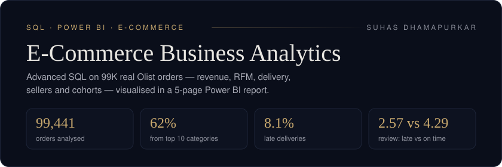
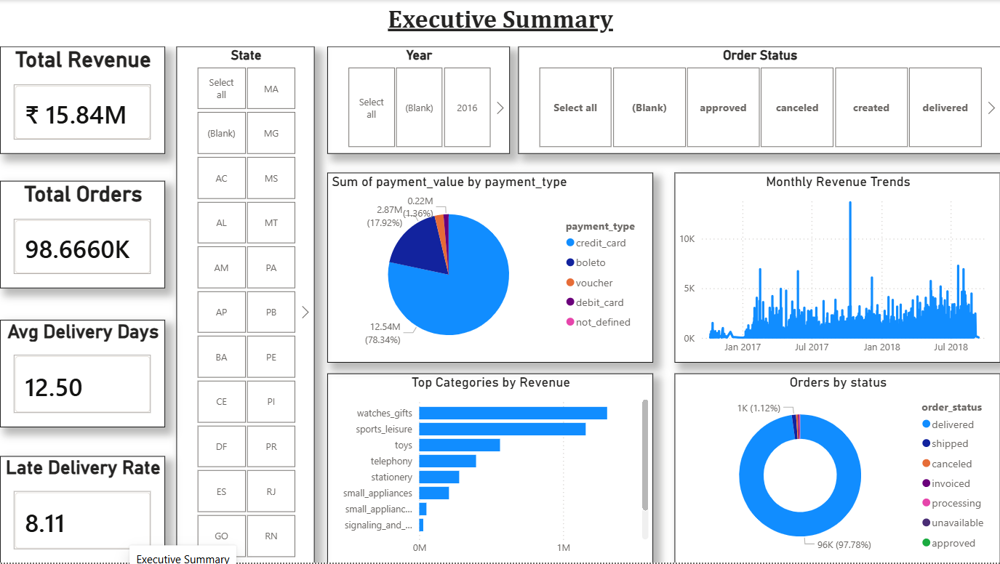

# E-Commerce Business Analytics | SQL & Power BI

<div align="center">




</div>

## Project Overview

An E-Commerce Business Analytics project using SQL, Python and Power BI to explore Brazilian Olist marketplace data. The project examines sales trends, customer behaviour, delivery performance and seller performance, translating query results into business insights and dashboard visualisations.

## Business Questions

| Business Question | SQL Module |
|---|---|
| Which product categories generate the most revenue? | `03_revenue_analysis.sql` |
| Who are the most valuable customers? | `04_customer_rfm.sql` |
| How does delivery performance affect customer reviews? | `05_delivery_analysis.sql` |
| Which sellers are underperforming? | `06_seller_performance.sql` |
| Do customers return to make repeat purchases? | `07_cohort_analysis.sql` |

## Key Findings

The following findings are based on the analysis outputs included in the `results/` folder.

| Area | Finding |
|---|---|
| Revenue | Top 10 product categories account for 62.4% of revenue. |
| Sales Trends | Revenue increased by 53.6% in November 2017 and decreased by 26.9% in December 2017. |
| Geographic Analysis | São Paulo generated approximately R$5.77M in revenue from 40,500 orders. |
| Delivery | Average delivery time was 12.5 days, with 8.1% of orders arriving late. |
| Customer Reviews | Late deliveries received an average review score of 2.57 compared with 4.29 for on-time deliveries. |
| Customer Segmentation | At Risk customers represented 7.7% of customers and 14.7% of revenue. |
| Seller Performance | The analysis identified 387 underperforming sellers. |

## Power BI Dashboard

<div align="center">

</div>

The Power BI report contains five analytical sections:

1. Executive Summary
2. Revenue Analysis
3. Customer Intelligence
4. Delivery Performance
5. Seller Scorecard

The dashboard uses KPIs, visualisations and drill-through features to explore business performance.

View the [Power BI dashboard guide](powerbi/README.md) or the [Power BI report](Dashboard.pbix).

## SQL Techniques

| Technique | Application |
|---|---|
| Common Table Expressions (CTEs) | Revenue analysis, RFM and cohort analysis |
| Window Functions | Customer scoring, seller ranking and monthly growth |
| Multi-table Joins | Combining customer, order, product and seller data |
| Subqueries and CASE WHEN | Segmentation and revenue analysis |
| Date Functions | Cohort and delivery-time analysis |
| Stored Procedures and Indexes | Reusable reports and query optimisation |

## Dataset

**Olist Brazilian E-Commerce Dataset** — [Kaggle Dataset](https://www.kaggle.com/datasets/olistbr/brazilian-ecommerce)

- 99,441 orders
- 112,650 order items
- 3,095 sellers
- 9 datasets/tables
- Data period: September 2016 – October 2018

## Project Structure

```text
ecommerce-sql-analytics/
├── sql/              SQL analysis scripts
├── data/             Olist CSV datasets
├── results/          Query output CSV files
├── powerbi/          Dashboard guide and screenshots
├── assets/           Project banner
├── Dashboard.pbix    Power BI report
├── load_data.py      Data loading script
├── run_analysis.py   Analysis execution script
└── README.md
```

## How to Run

### 1. Create the database schema

```bash
mysql -u root -p ecommerce < sql/01_schema_setup.sql
```

### 2. Load the datasets

```bash
python load_data.py
```

### 3. Run the analysis

```bash
python run_analysis.py
```

## Project Attribution

**Project adaptation and portfolio presentation by Ghaziah Shoeb**

This repository is a learning-oriented replication and adaptation of the original project. The original project structure and analytical work are credited to its creator.

**Original Creator:** [Suhas Dhamapurkar](https://github.com/Suhas5497)

**Original Repository:** [ecommerce-sql-analytics](https://github.com/Suhas5497/ecommerce-sql-analytics)

**My GitHub:** [Ghaziah Shoeb](https://github.com/GhaziahShoeb)

